<h1 align="center">Aura domu</h1>

<p align="center"><b>A full-screen dashboard card for Home Assistant</b><br>Home, rooms, climate, heating, weather, energy, security, bin collection and Formula 1 — in one card.</p>

<p align="center">
  <a href="https://github.com/krystianokris/aura-domu/releases"></a>
  <a href="https://hacs.xyz"></a>
  
</p>

<p align="center"><b>English</b> · <a href="README.pl.md">Polski</a> · <a href="https://krystianokris.github.io/aura-domu/demo/">Live demo</a></p>

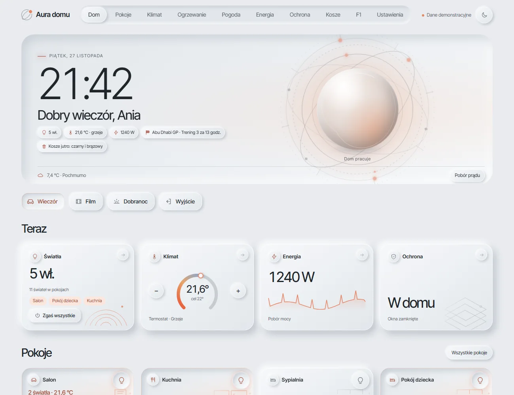

A soft neumorphic look, light and dark theme, drawn scenes instead of photos, and tiles that rise out of concave dimples when you open a tab. Works on a desktop, a wall tablet and a phone.

> **Version 0.10 (beta).** The interface is in **English and Polish**: it follows the language of your Home Assistant profile (Polish → Polish, anything else → English), or set `language: en` / `pl` (also switchable per device in **Settings**). Room and device names come from your own Home Assistant areas and entities. Feedback and ideas are very welcome: [report a bug or suggest a change](../../issues/new/choose).

## Contents
[Features](#features) · [Installation](#installation) · [Zero-config start](#zero-config-start) · [Configuration](#configuration) · [Options](#all-options) · [Full screen](#full-screen-dashboard) · [FAQ](#faq)

## Features

### Home
Clock, greeting and a **home mood orb**: its colour follows room temperatures, its pulse follows power draw, red means an alarm. Below: scenes, *Now* tiles — lights with "turn all off", thermostat, energy with a chart, security — and rooms. Events such as the doorbell, a leak, CO or finished laundry appear on the orb, and reminders show up when the bins go out tomorrow or an F1 weekend is on.

| Light | Dark | Phone |
|---|---|---|
|  | 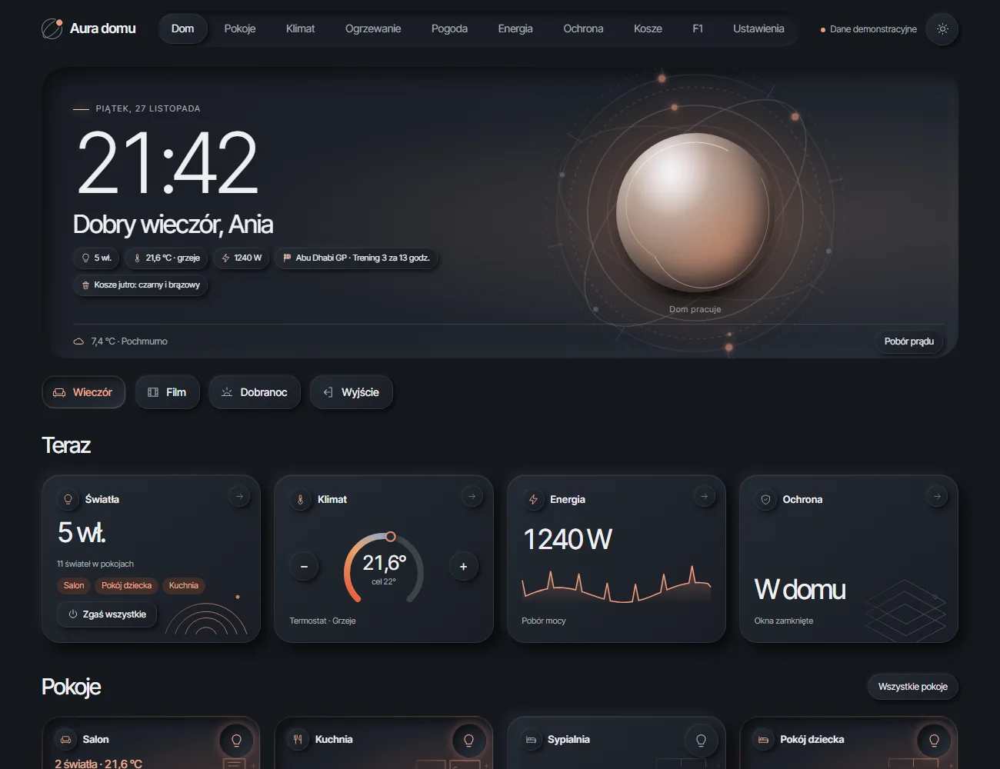 | 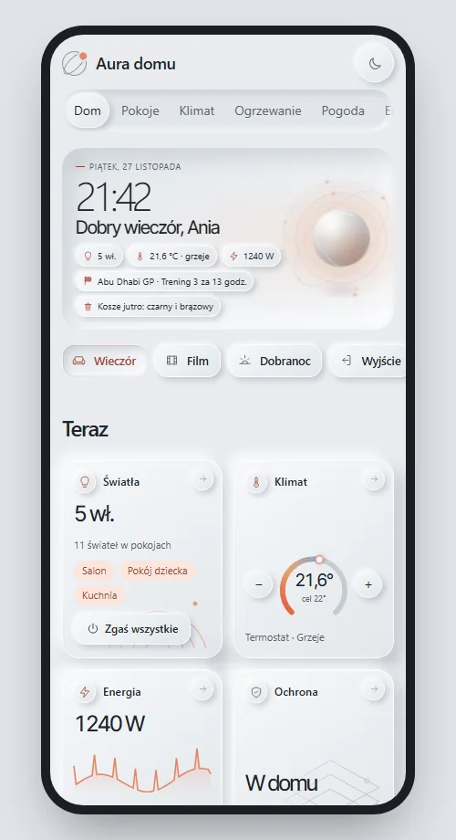 |

### Rooms
Room tiles with temperature and light count (the bulb switches the whole room). Inside a room: **Lights** (with brightness slider), **Climate**, **Media**, **Sensors** and **Devices** — washer, dryer, 3D printer, litter box, pet feeder, air purifier… plus a room switcher at the bottom.

| Rooms | Room | Room on a phone |
|---|---|---|
| 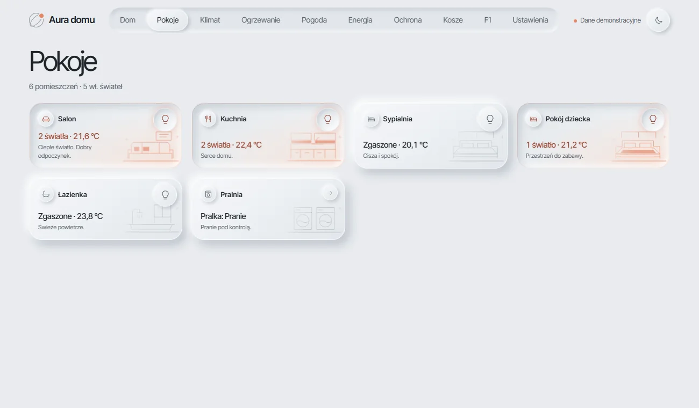 | 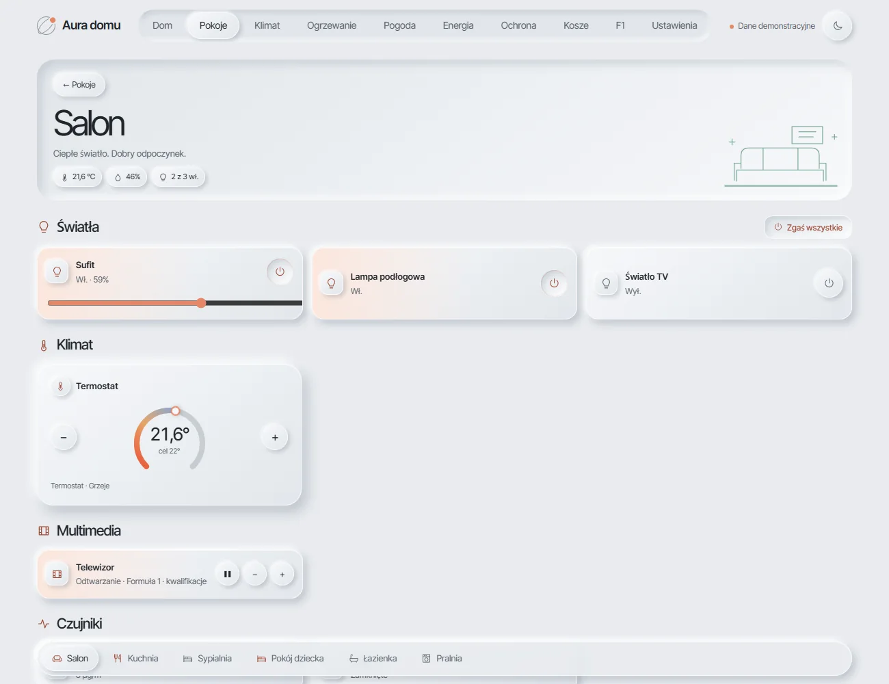 | 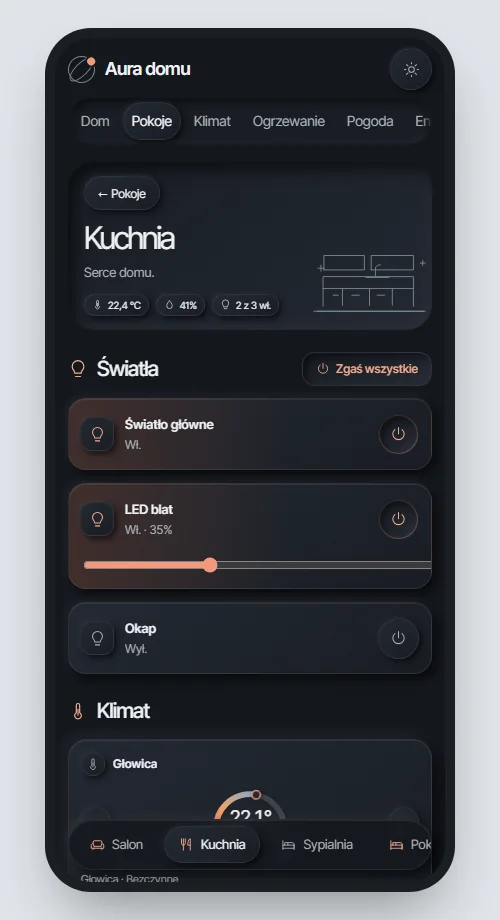 |

### Climate & Heating
Temperature and humidity of every room and all thermostats. **Heating** shows the boiler (flame and flowing pipes while it heats), radiator circuits with valves and floor heating, **Auto / Comfort / Eco / Boost** modes (applied on a second tap), gas used today and boiler run time from history.

| Climate | Heating |
|---|---|
| 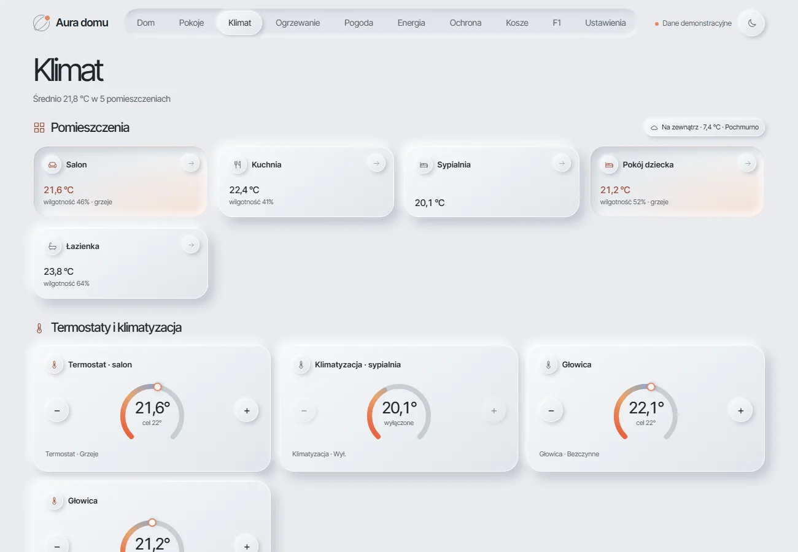 | 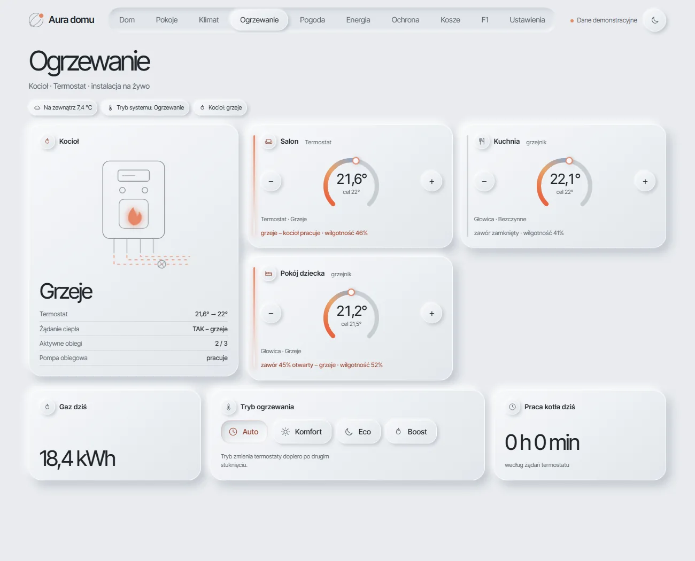 |

### Weather
An animated drawn scene — sun, moon and stars, clouds, rain, snow, hail, fog, wind and storms; the house window lights up at night and the chimney smokes on cold days. Wind with a compass, humidity, pressure, sunrise and sunset, an hourly forecast with a temperature curve and a daily forecast.

| Light | Dark |
|---|---|
| 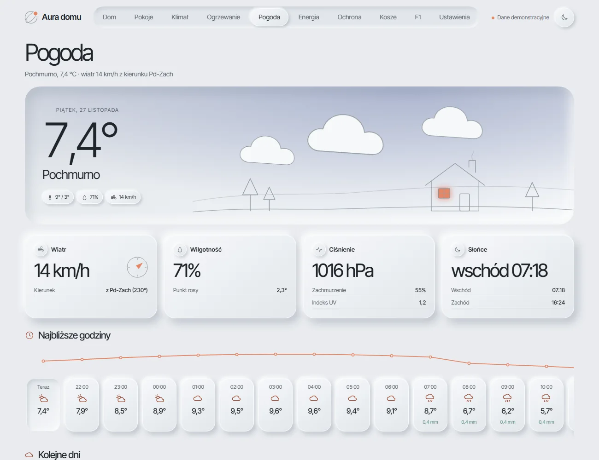 | 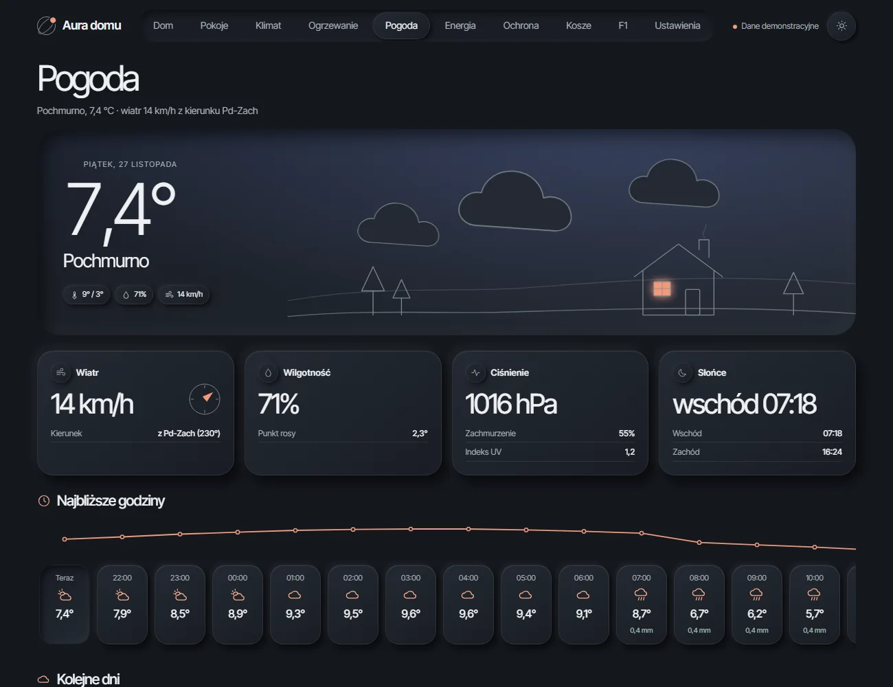 |

### Energy, Security, Bins
**Energy** — power now, electricity, gas and water, price, per-device usage. **Security** — alarm mode, windows, leaks, CO, motion, cameras and sensor batteries (low ones in red). **Bins** — collections from [Waste Collection Schedule](https://github.com/mampfes/hacs_waste_collection_schedule) with drawn bins in their colours, what goes out next and when.

| Energy | Security | Bins |
|---|---|---|
| 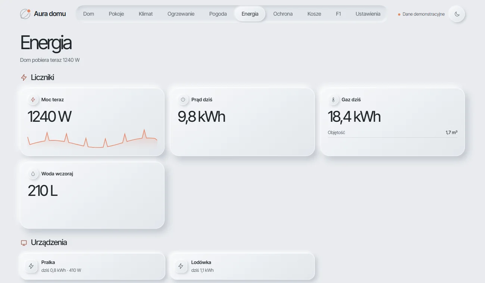 | 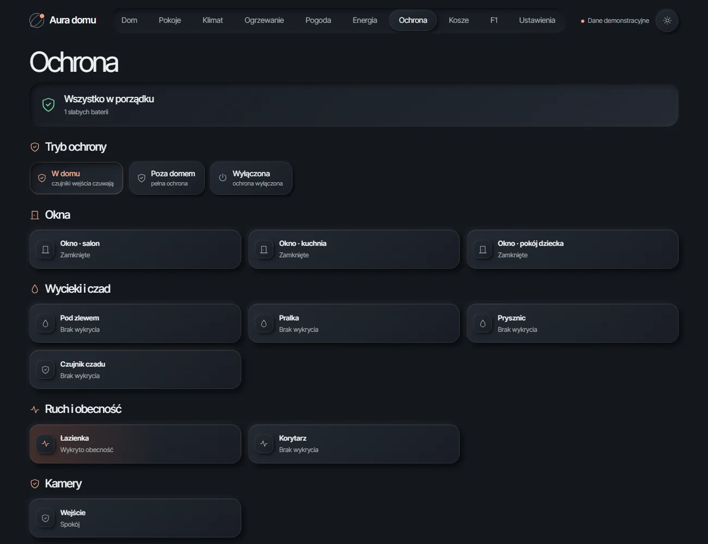 | 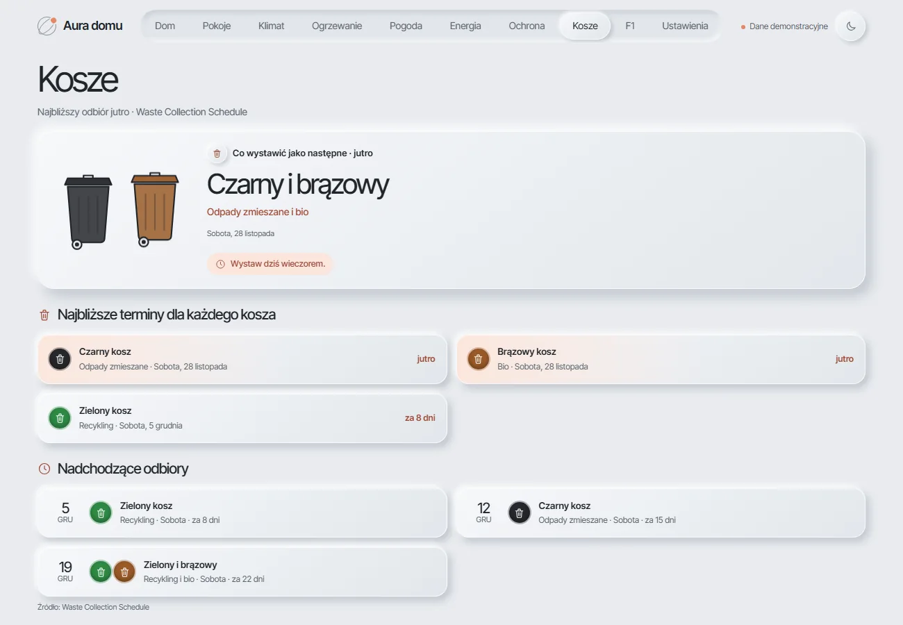 |

### Formula 1
From [F1 Sensor](https://github.com/Nicxe/f1_sensor): race countdown, the weekend schedule in your time zone, last race podium, driver and constructor standings, circuit facts and race weather. During a session there is a **live mode**: track status in the flag colour, laps, positions and race control messages. No-spoiler mode is respected.

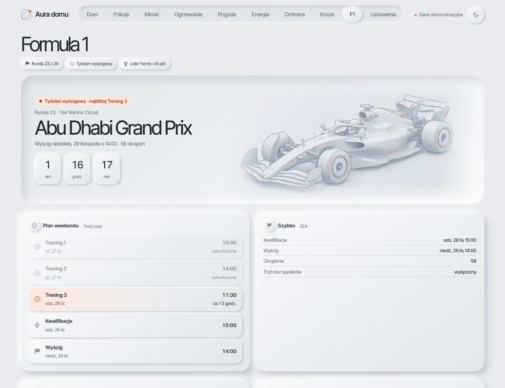

### Settings
Theme (light, dark, system), **language** (same as Home Assistant, Polski, English), **show / hide tabs** (remembered on each device, like the theme; set `hidden_tabs` for a default everywhere), a **ready-made configuration** to copy, and a link to Home Assistant settings.

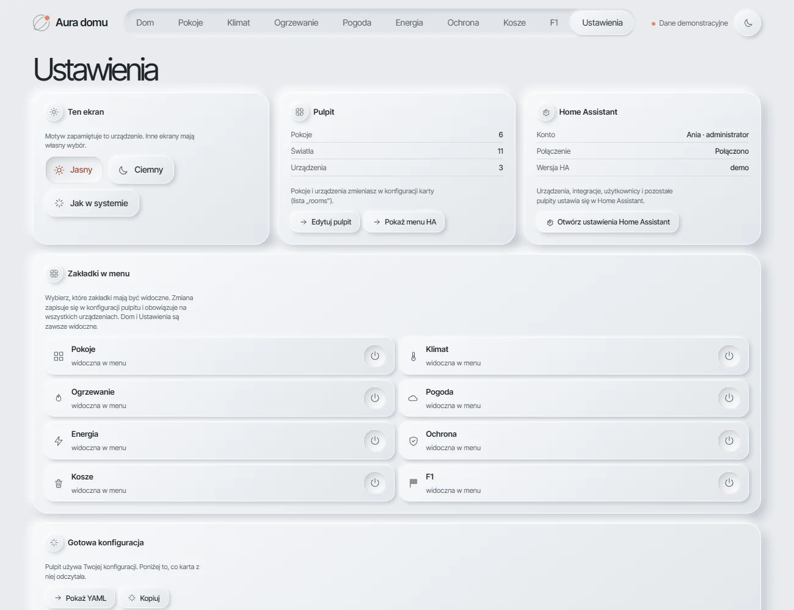

## Installation

### HACS (recommended)
1. HACS → ⋮ menu → **Custom repositories**.
2. URL `https://github.com/krystianokris/aura-domu`, category **Dashboard** → **Add**.
3. Find **Aura domu** → **Download**, then hard-refresh the browser (Ctrl+Shift+R).

### Manual
1. Download `aura-domu.js` from the [latest release](../../releases/latest) to `/config/www/aura-domu.js`.
2. **Settings → Dashboards → ⋮ → Resources → Add resource**: `/local/aura-domu.js?v=0.12.1`, type **JavaScript module**.
3. Change `?v=` after every update — browsers cache `/local` files for up to 31 days.

### Add the dashboard
Create a new dashboard from scratch, open **⋮ → Edit dashboard → ⋮ → Raw configuration editor** and paste:
```yaml
views:
  - title: Home
    path: dom
    type: panel
    cards:
      - type: custom:aura-domu
```

## Zero-config start

`type: custom:aura-domu` alone shows the whole dashboard. The card builds it from your Home Assistant **areas**:

| What | From |
|---|---|
| **Rooms** | Each area: lights (and switches with "light / lamp / LED" in the name), fans, thermostats, media players, **cameras** (with a live snapshot), window and door sensors, leak, motion and CO sensors, air purifiers; room temperature and humidity from a room sensor. Diagnostic and hidden entities are skipped. |
| **Security** | Windows, leaks, CO, motion, cameras and alarm from all areas, plus the batteries of those sensors. |
| **Heating** | Heating thermostats (air conditioners excluded), one circuit per room, floor heating separately; the main thermostat is recognised by integration (Nest, Ecobee, Tado…). |
| **Weather, Bins, F1** | When you have a weather entity, Waste Collection Schedule (or your own `bins.schedule`) or F1 Sensor. |

> Assign your devices to areas (**Settings → Areas**) and the rooms build themselves.

**Settings → Ready-made configuration** shows everything the card picked as YAML: **Copy** it and paste it into the dashboard editor (**Edit dashboard → ⋮ → Raw configuration editor**). Then just rename things, add devices (washer, printer, litter box…) and remove what you don't need.

## Configuration

Once you list your own `rooms`, the card shows **only those entities**.

```yaml
type: custom:aura-domu
weather_entity: weather.home
climate_entity: climate.living_room
power_entity: sensor.house_power
scenes: [scene.evening, scene.movie, scene.good_night]
rooms:
  - id: living
    name: Living room
    temperature: sensor.living_temperature
    humidity: sensor.living_humidity
    lights:
      - {entity: light.living_ceiling, name: Ceiling}
      - {entity: switch.living_lamp, name: Lamp}
    climate:
      - {entity: climate.living_room, name: Thermostat}
    media:
      - {entity: media_player.living_tv, name: TV}
    sensors:
      - {entity: binary_sensor.living_window, name: Window, type: window}
```

| Example | Contents |
|---|---|
| [`examples/minimal.yaml`](examples/minimal.yaml) | Zero-config start |
| [`examples/aura-domu.yaml`](examples/aura-domu.yaml) | Full dashboard with every tab |
| [`examples/rooms-and-devices.yaml`](examples/rooms-and-devices.yaml) | Rooms and devices: washer, dryer, 3D printer, litter box, feeder, purifier |
| [`examples/tabs.yaml`](examples/tabs.yaml) | Heating, Energy, Security, Bins, F1, hidden tabs |
| [`examples/bins.yaml`](examples/bins.yaml) | Bin collection without an integration (colour, start date, every N days) |

## All options

### Card
| Option | Description |
|---|---|
| `title` | Name in the top-left corner (default "Aura domu"). |
| `name` | Name in the greeting (default: your HA user). |
| `weather_entity` | Weather entity (default: the first one found). |
| `climate_entity` | Thermostat on the *Climate* tile of the home screen. |
| `power_entity` | House power draw (W or kW). |
| `price_entity`, `price_cheap`, `price_expensive` | Electricity price and the colour thresholds. |
| `scenes` | Scenes under the orb: `scene.x` or `{entity, name, icon}`. |
| `rooms` | Room list (below). Without it: rooms from HA areas. |
| `climate` | Extra thermostats on the Climate tab: `[{entity, name}]`. |
| `heating_page`, `energy_page`, `security_page` | Heating, Energy, Security tabs — see [`examples/tabs.yaml`](examples/tabs.yaml). |
| `bins` | `{calendar, sensor, types, schedule}` — Waste Collection Schedule is detected automatically. **No integration?** Use `schedule`: a list of bins with `color`, `type`, `start` (first collection) and `every` (days) or `weeks`, or one-off `dates` — see [`examples/bins.yaml`](examples/bins.yaml). |
| `f1` | Override F1 Sensor entities, e.g. `{led: automation.f1_flags}`. |
| `hidden_tabs` | Hidden tabs: `rooms`, `climate`, `heating`, `weather`, `energy`, `security`, `bins`, `f1`. |
| `event_entities` | Custom orb events: `{sensor.x: {to: "done", title: "…", text: "…"}}`. |
| `language` | `en` or `pl`. Default: the language of your HA profile (Polish → `pl`, anything else → `en`). A choice made in **Settings → Language** on a device wins over this. |
| `load_font` | `false` disables the Inter Tight font from Google Fonts. |

### Room (`rooms[]`)
| Option | Description |
|---|---|
| `id`, `name`, `subtitle` | Id (URL `#pokoje/id`), name and subtitle. |
| `temperature`, `humidity` | A sensor, a `climate.*` entity (uses `current_temperature`) or `entity#attribute`. |
| `lights` | `{entity, name, type}` — `type: fan` is shown but not counted as a light. |
| `climate` | `{entity, name, note}` — thermostats and air conditioners. |
| `media` | `{entity, name, volume_entity, speaker}` — play / pause and volume. |
| `cameras` | `{entity, name}` — camera snapshot (refreshed every 30 s); tap for the live view. Also in `security_page.cameras` as `entity`. |
| `sensors` | `{entity, name, type}` — `type`: `window`, `leak`, `motion`, `co`, `battery`, `pm`, `aq`. |
| `devices` | `{type, name, status, …}` — `type`: `washer`, `dryer`, `printer`, `purifier`, `pet_feeder`, `litter_box`; any other entity fields (`remaining`, `progress`, `filter`…) are shown as rows; `switches`, `problems` and buttons (`pause`, `resume`, `stop`, `feed`, `clean`, `power`, `light`). |

## Full-screen dashboard
No HA header or sidebar, as in the screenshots: install [kiosk-mode](https://github.com/NemesisRE/kiosk-mode) and add at the top of the dashboard YAML:
```yaml
kiosk_mode:
  kiosk: true
```
HA settings are then reached from the card's **Settings** tab. To edit the dashboard, add `?disable_km&edit=1` to the URL or use the **Edit dashboard** button in Settings. **Show HA menu** brings back the HA sidebar.

## FAQ

**"Custom element doesn't exist: aura-domu".** The browser has an old copy cached — hard-refresh (Ctrl+Shift+R); for manual installs bump `?v=` in the resource URL.

**A tab is missing.** Tabs without data hide themselves (e.g. Bins without Waste Collection Schedule). Also check **Settings → Menu tabs**.

**Too much or too little in a room.** In zero-config mode the card uses your areas. Copy the ready configuration, remove what you don't need and add what is missing.

**Does the card change anything on its own?** No. It only controls what you tap, and changing a heating mode needs a second tap. It never edits your dashboard configuration.

## Feedback
This is a beta — every comment helps: [report a bug or suggest a change](../../issues/new/choose). With a bug, please include the card version (the browser console shows `AURA-DOMU v…`), your HA version and the relevant part of your config, without passwords or tokens.

## License
[MIT](LICENSE)
