<h1 align="center">Aura domu</h1>

<p align="center"><b>Pulpit na cały ekran dla Home Assistanta</b><br>Dom, pokoje, klimat, ogrzewanie, pogoda, energia, ochrona, kosze i Formuła 1 — w jednej karcie.</p>

<p align="center">
  <a href="https://github.com/krystianokris/aura-domu/releases"></a>
  <a href="https://hacs.xyz"></a>
  
</p>

<p align="center"><a href="README.md">English</a> · <b>Polski</b> · <a href="https://krystianokris.github.io/aura-domu/demo/">Demo w przeglądarce</a></p>

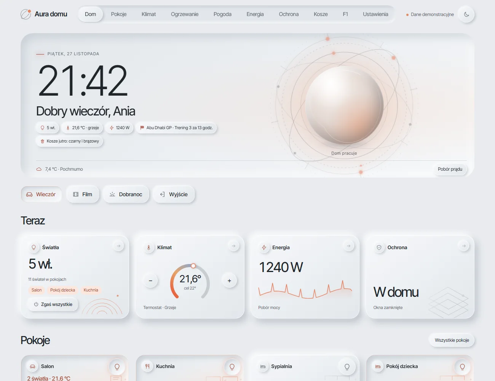

Miękki, „wypukły” wygląd (neumorfizm), jasny i ciemny motyw, rysowane sceny zamiast zdjęć i kafelki, które przy wejściu na zakładkę wyłaniają się z wklęsłych dołków. Działa na komputerze, tablecie na ścianie i telefonie.

> **Wersja 0.10 (beta).** Czekam na opinie i pomysły — [zgłoś błąd albo zaproponuj zmianę](../../issues/new/choose). Interfejs jest po polsku i po angielsku: karta bierze język z profilu użytkownika HA (polski → polski, każdy inny → angielski), a `language: pl` albo `en` wymusza język. Można go też zmienić na danym urządzeniu w **Ustawieniach**.

## Spis treści
[Co potrafi](#co-potrafi) · [Instalacja](#instalacja) · [Start bez konfiguracji](#start-bez-konfiguracji) · [Konfiguracja](#konfiguracja) · [Opcje](#wszystkie-opcje) · [Pełny ekran](#pulpit-na-cały-ekran) · [FAQ](#faq)

## Co potrafi

### Dom
Zegar, powitanie i **kula nastroju domu**: kolor zależy od temperatury w pokojach, tempo pulsowania od poboru prądu, czerwień oznacza alarm. Pod spodem sceny, kafelki *Teraz* (światła z „Zgaś wszystkie”, termostat, energia z wykresem, ochrona) i pokoje. Zdarzenia — dzwonek, wyciek, czad, koniec prania — pojawiają się na kuli. Gdy jutro jest odbiór śmieci albo trwa weekend F1, pokazuje się przypomnienie.

| Jasny | Ciemny | Telefon |
|---|---|---|
|  | 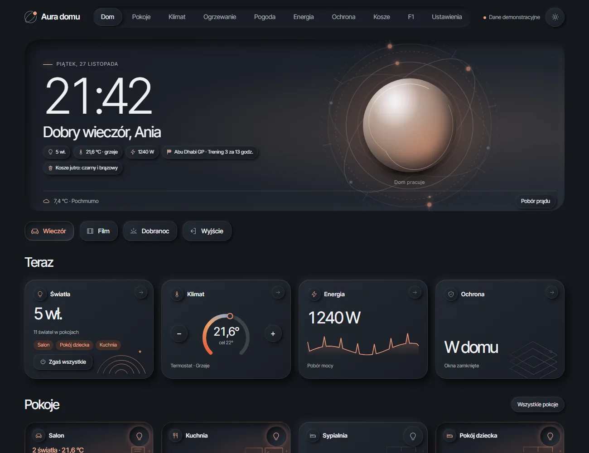 | 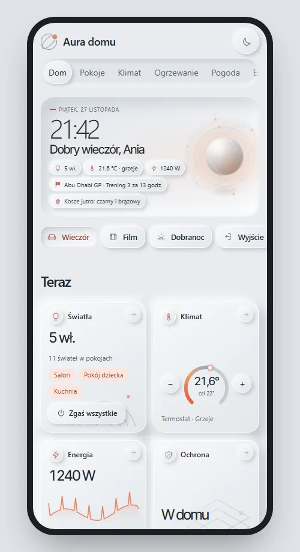 |

### Pokoje
Kafelki pokoi z temperaturą i liczbą świateł (żarówka zapala lub gasi cały pokój). W pokoju sekcje **Światła** (z suwakiem jasności), **Klimat**, **Multimedia**, **Czujniki** i **Urządzenia** — pralka, suszarka, drukarka 3D, kuweta, karmnik, oczyszczacz… Na dole pasek do przełączania pokoi.

| Pokoje | Pokój | Pokój na telefonie |
|---|---|---|
| 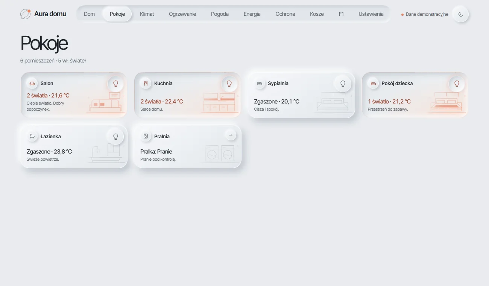 | 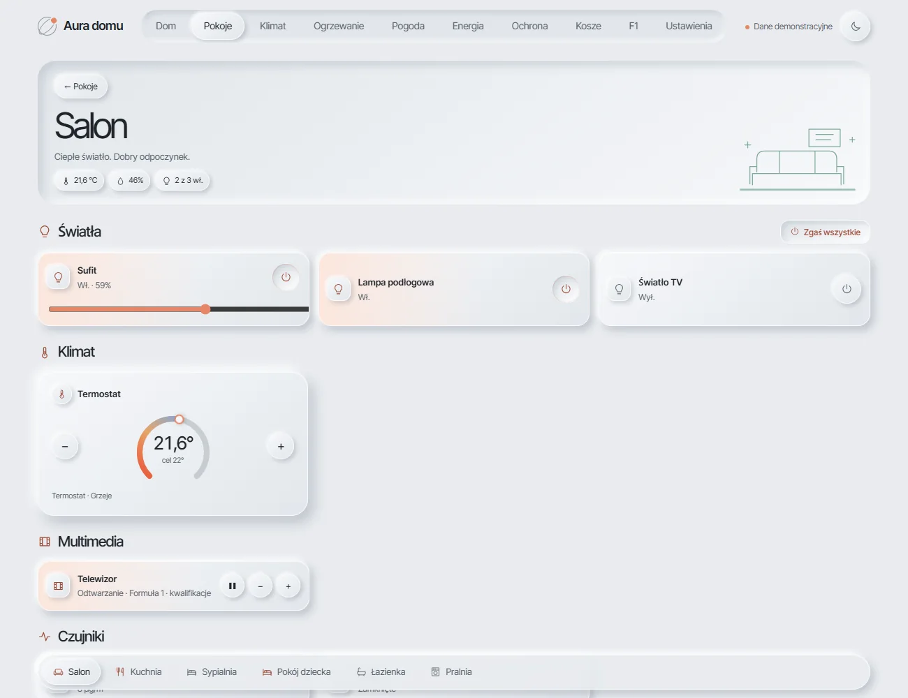 | 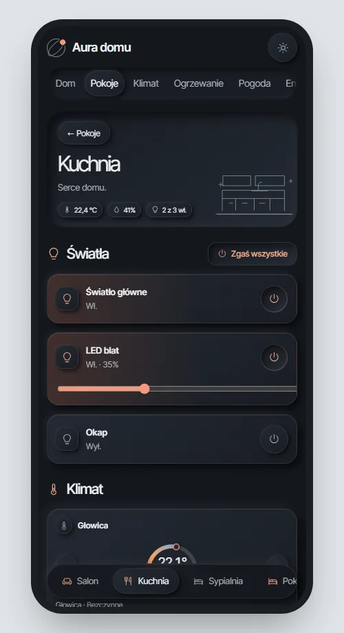 |

### Klimat i Ogrzewanie
Temperatura i wilgotność każdego pokoju i wszystkie termostaty. **Ogrzewanie** pokazuje kocioł (płomień i przepływ w rurach, gdy grzeje), obiegi pokoi z zaworami i podłogówką, tryby **Auto / Komfort / Eco / Boost** (zmiana dopiero po drugim stuknięciu), gaz dziś i czas pracy kotła z historii.

| Klimat | Ogrzewanie |
|---|---|
| 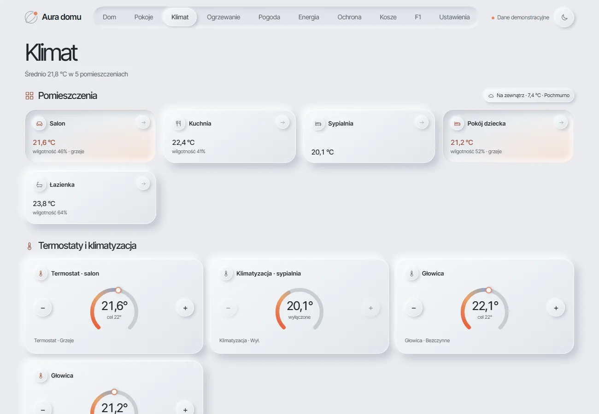 | 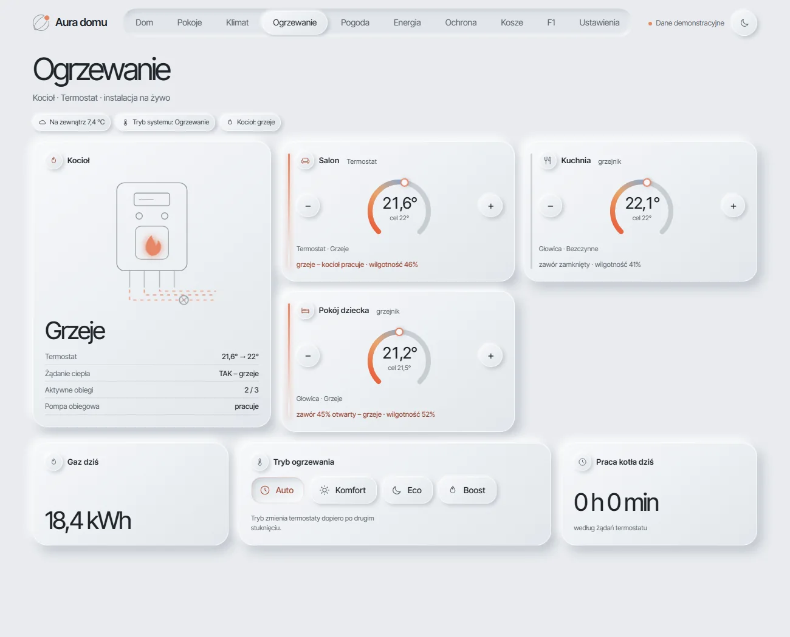 |

### Pogoda
Rysowana, animowana scena: słońce, księżyc z gwiazdami, chmury, deszcz, śnieg, grad, mgła, wiatr i burza; wieczorem w oknie domu pali się światło, w zimne dni z komina leci dym. Do tego wiatr z kompasem, wilgotność, ciśnienie, wschód i zachód słońca, prognoza godzinowa z wykresem i prognoza na kolejne dni.

| Jasny | Ciemny |
|---|---|
| 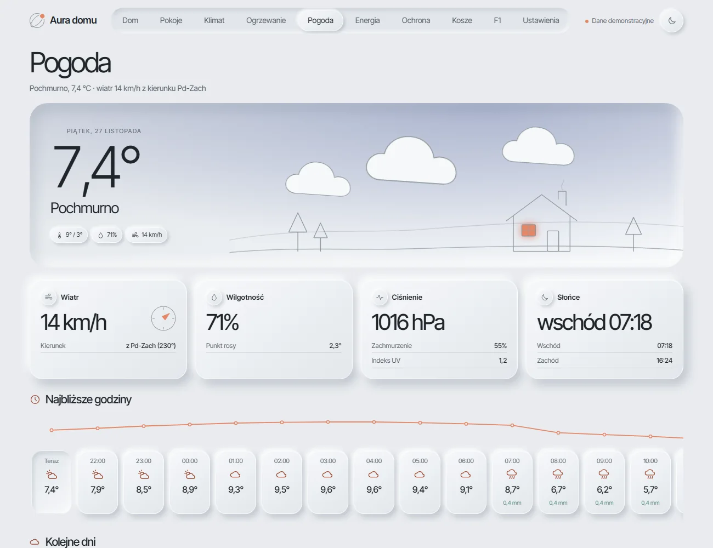 | 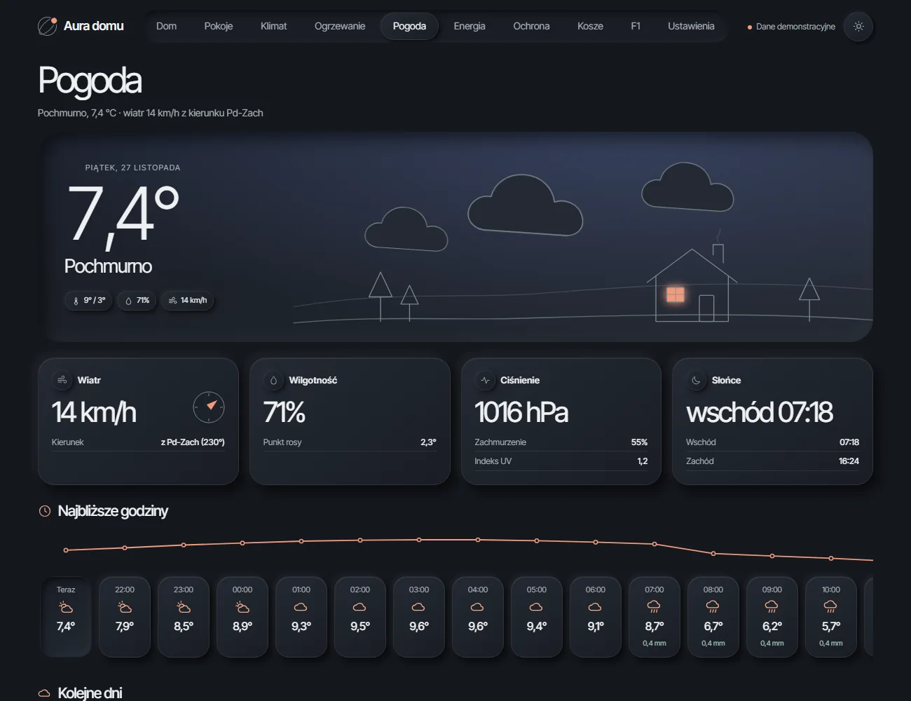 |

### Energia, Ochrona, Kosze
**Energia** — moc teraz, prąd, gaz i woda, cena, zużycie urządzeń. **Ochrona** — tryb ochrony, okna, wycieki, czad, ruch, kamery i baterie czujników (słabe na czerwono). **Kosze** — odbiory z [Waste Collection Schedule](https://github.com/mampfes/hacs_waste_collection_schedule): rysowane kosze w kolorach, „co wystawić”, kiedy i podpowiedź „wystaw w poniedziałek wieczorem”.

| Energia | Ochrona | Kosze |
|---|---|---|
| 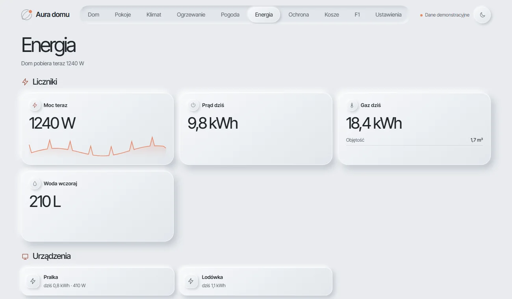 | 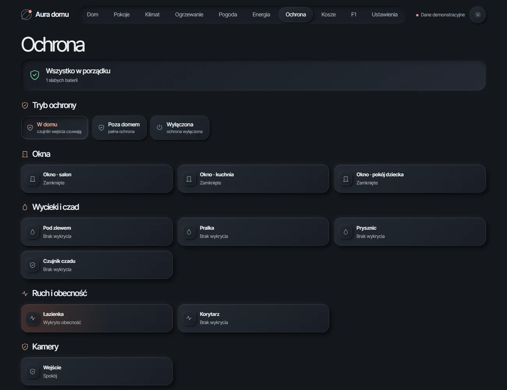 | 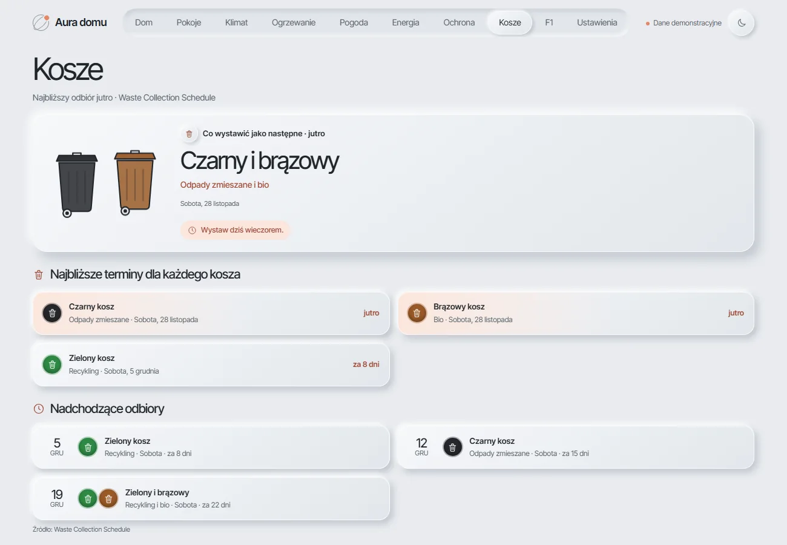 |

### Formuła 1
Z integracji [F1 Sensor](https://github.com/Nicxe/f1_sensor): odliczanie do wyścigu, plan weekendu w Twoim czasie, podium ostatniego wyścigu, klasyfikacje kierowców i zespołów, fakty o torze i pogoda na wyścig. W trakcie sesji **tryb na żywo**: stan toru w kolorze flagi, okrążenia, pozycje i komunikaty dyrekcji wyścigu. Szanuje tryb bez spoilerów.

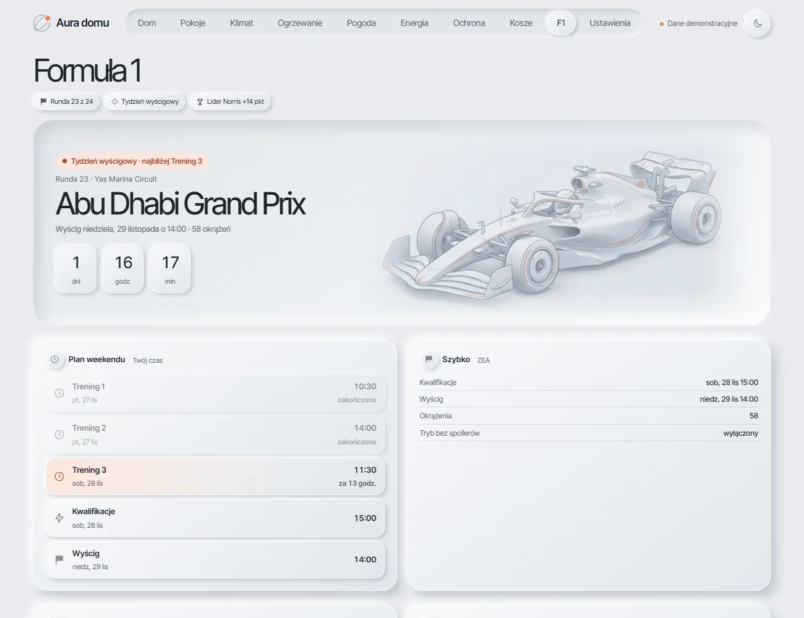

### Ustawienia
Motyw (jasny, ciemny, jak w systemie), **język** (jak w Home Assistant, polski, angielski), **włączanie i wyłączanie zakładek** (zapamiętuje je każde urządzenie, jak motyw; `hidden_tabs` ustawia domyślne dla wszystkich), **gotowa konfiguracja** do skopiowania i wejście do ustawień Home Assistanta.

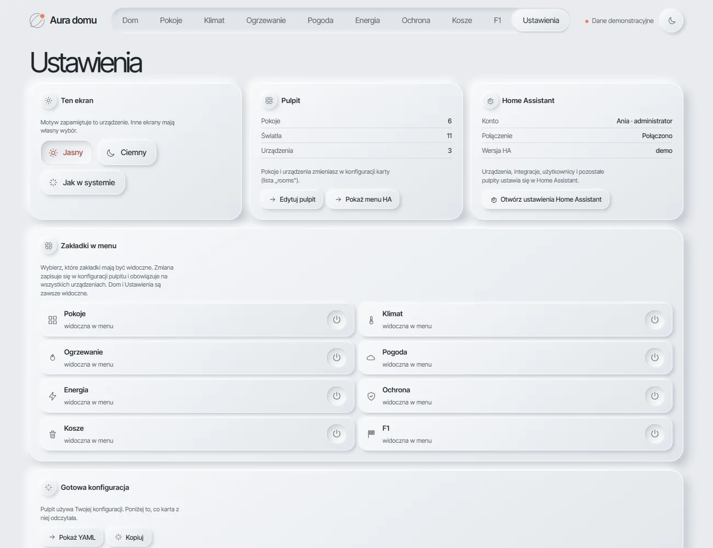

## Instalacja

### HACS (zalecane)
1. HACS → menu ⋮ → **Repozytoria niestandardowe**.
2. Adres `https://github.com/krystianokris/aura-domu`, kategoria **Dashboard** (Pulpit) → **Dodaj**.
3. Znajdź **Aura domu** → **Pobierz**. Odśwież przeglądarkę (Ctrl+Shift+R).

HACS sam doda zasób i będzie informował o nowych wersjach.

### Ręcznie
1. Pobierz `aura-domu.js` z [najnowszego wydania](../../releases/latest) i skopiuj do `/config/www/aura-domu.js`.
2. **Ustawienia → Pulpity → ⋮ → Zasoby → Dodaj zasób**: `/local/aura-domu.js?v=0.12.1`, typ **Moduł JavaScript**.
3. Przy każdej aktualizacji zmień `?v=` na nowy numer — przeglądarka trzyma pliki z `/local` nawet 31 dni.

### Dodanie pulpitu
1. **Ustawienia → Pulpity → Dodaj pulpit → Nowy pulpit od zera**, np. „Dom”.
2. Otwórz go, **⋮ → Edytuj pulpit → ⋮ → Edytor kodu (YAML)** i wklej:
```yaml
views:
  - title: Dom
    path: dom
    type: panel
    cards:
      - type: custom:aura-domu
```
3. Zapisz. Gotowe.

## Start bez konfiguracji

Samo `type: custom:aura-domu` wystarczy, żeby zobaczyć cały pulpit. Karta buduje go z **obszarów Home Assistanta**:

| Co | Skąd |
|---|---|
| **Pokoje** | Każdy obszar: światła (także przełączniki z „światło / lamp / LED” w nazwie), wentylatory, termostaty, multimedia, **kamery** (z podglądem), okna i drzwi, czujniki zalania, ruchu i czadu, oczyszczacze. Temperatura i wilgotność z czujnika pokojowego. Encje diagnostyczne i ukryte są pomijane. |
| **Ochrona** | Okna, wycieki, czad, ruch, kamery i alarm ze wszystkich obszarów oraz baterie tych czujników. |
| **Ogrzewanie** | Termostaty grzewcze (bez klimatyzatorów), jeden obieg na pokój, podłogówka osobno. Główny termostat rozpoznany po integracji (np. Nest, Ecobee, Tado). |
| **Pogoda, Kosze, F1** | Gdy masz encję pogody, Waste Collection Schedule albo F1 Sensor. |

> Przypisz urządzenia do obszarów (**Ustawienia → Obszary**), a pokoje ułożą się same.

### Gotowa konfiguracja
W zakładce **Ustawienia → Gotowa konfiguracja** zobaczysz wszystko, co karta dobrała, jako YAML:

- **Kopiuj** — wklej w edytorze YAML pulpitu (edycja pulpitu → ⋮) i dopasuj.

Potem zostaje tylko poprawić nazwy, dopisać urządzenia (pralka, drukarka, kuweta…) i usunąć to, czego nie chcesz.

## Konfiguracja

Gdy wpiszesz własną listę `rooms`, karta pokazuje **tylko te encje** — dokładnie tak, jak chcesz.

```yaml
type: custom:aura-domu
weather_entity: weather.home
climate_entity: climate.salon
power_entity: sensor.dom_moc
scenes: [scene.wieczor, scene.film, scene.dobranoc]
rooms:
  - id: salon
    name: Salon
    subtitle: Ciepłe światło. Dobry odpoczynek.
    temperature: sensor.salon_temperatura
    humidity: sensor.salon_wilgotnosc
    lights:
      - {entity: light.salon_sufit, name: Sufit}
      - {entity: switch.salon_lampa, name: Lampa}
    climate:
      - {entity: climate.salon, name: Termostat}
    media:
      - {entity: media_player.salon_tv, name: Telewizor}
    sensors:
      - {entity: binary_sensor.salon_okno, name: Okno, type: window}
```

Więcej przykładów:

| Plik | Co zawiera |
|---|---|
| [`examples/minimal.yaml`](examples/minimal.yaml) | Start bez konfiguracji |
| [`examples/aura-domu.yaml`](examples/aura-domu.yaml) | Pełny pulpit ze wszystkimi zakładkami |
| [`examples/rooms-and-devices.yaml`](examples/rooms-and-devices.yaml) | Pokoje i urządzenia: pralka, suszarka, drukarka 3D, kuweta, karmnik, oczyszczacz |
| [`examples/tabs.yaml`](examples/tabs.yaml) | Ogrzewanie, Energia, Ochrona, Kosze, F1, ukrywanie zakładek |
| [`examples/bins.yaml`](examples/bins.yaml) | Kosze bez integracji (kolor, pierwszy odbiór, co ile dni) |

## Wszystkie opcje

### Karta
| Opcja | Opis |
|---|---|
| `title` | Nazwa w lewym górnym rogu (domyślnie „Aura domu”). |
| `name` | Imię w powitaniu (domyślnie z konta HA). |
| `weather_entity` | Encja pogody (domyślnie pierwsza znaleziona). |
| `climate_entity` | Termostat na kafelku *Klimat* na stronie Dom. |
| `power_entity` | Chwilowy pobór mocy domu (W lub kW). |
| `price_entity`, `price_cheap`, `price_expensive` | Cena prądu i progi kolorów „tanio / średnio / drogo”. |
| `scenes` | Sceny pod kulą: `scene.x` albo `{entity, name, icon}`. |
| `rooms` | Lista pokoi (niżej). Bez niej — pokoje z obszarów HA. |
| `climate` | Dodatkowe termostaty na zakładce Klimat: `[{entity, name}]`. |
| `heating_page`, `energy_page`, `security_page` | Zakładki Ogrzewanie, Energia, Ochrona — [`examples/tabs.yaml`](examples/tabs.yaml). |
| `bins` | `{calendar, sensor, types, schedule}` — Waste Collection Schedule jest wykrywany sam. **Bez integracji?** Użyj `schedule`: lista koszy z `color`, `type`, `start` (pierwszy odbiór) i `every` (co ile dni) albo `weeks`, albo pojedyncze `dates` — zobacz [`examples/bins.yaml`](examples/bins.yaml). |
| `f1` | Nadpisanie encji F1 Sensor, np. `{led: automation.flagi_f1}`. |
| `hidden_tabs` | Ukryte zakładki: `rooms`, `climate`, `heating`, `weather`, `energy`, `security`, `bins`, `f1`. |
| `event_entities` | Własne zdarzenia na kuli: `{sensor.x: {to: "done", title: "…", text: "…"}}`. |
| `language` | `pl` albo `en`. Domyślnie język z profilu użytkownika HA (polski → `pl`, każdy inny → `en`). Wybór w **Ustawienia → Język** na danym urządzeniu ma pierwszeństwo. |
| `load_font` | `false` wyłącza font Inter Tight z Google Fonts. |

### Pokój (`rooms[]`)
| Opcja | Opis |
|---|---|
| `id`, `name`, `subtitle` | Identyfikator (adres `#pokoje/id`), nazwa i podpis. |
| `temperature`, `humidity` | Czujnik albo `climate.*` (bierze `current_temperature`), albo `encja#atrybut`. |
| `lights` | `{entity, name, type}` — `type: fan` = pokazane, ale nieliczone jako światło. |
| `climate` | `{entity, name, note}` — termostaty i klimatyzacje. |
| `media` | `{entity, name, volume_entity, speaker}` — odtwórz / pauza i głośność. |
| `cameras` | `{entity, name}` — podgląd z kamery (odświeżany co 30 s); stuknięcie otwiera obraz na żywo. Także w `security_page.cameras` jako `entity`. |
| `sensors` | `{entity, name, type}` — `type`: `window`, `leak`, `motion`, `co`, `battery`, `pm`, `aq`. |
| `devices` | `{type, name, status, …}` — `type`: `washer`, `dryer`, `printer`, `purifier`, `pet_feeder`, `litter_box`; dowolne pola z encjami (`remaining`, `progress`, `filter`…) pokazują się jako wiersze; `switches`, `problems` i przyciski (`pause`, `resume`, `stop`, `feed`, `clean`, `power`, `light`). |

## Pulpit na cały ekran
Bez paska HA i menu bocznego — jak na zrzutach. Zainstaluj [kiosk-mode](https://github.com/NemesisRE/kiosk-mode) z HACS i dodaj na górze YAML pulpitu:
```yaml
kiosk_mode:
  kiosk: true
```
Do ustawień HA wchodzisz wtedy z zakładki **Ustawienia** karty. Żeby edytować pulpit, dopisz do adresu `?disable_km&edit=1` albo użyj przycisku „Edytuj pulpit” w Ustawieniach.

## FAQ

**Widzę „Custom element doesn't exist: aura-domu”.** Przeglądarka ma starą wersję w pamięci. Zrób twarde odświeżenie (Ctrl+Shift+R); przy instalacji ręcznej zmień `?v=` w adresie zasobu.

**Nie widzę jakiejś zakładki.** Zakładka bez danych chowa się sama (np. Kosze bez Waste Collection Schedule). Sprawdź też **Ustawienia → Zakładki w menu**.

**Karta pokazuje za dużo albo za mało w pokoju.** W trybie automatycznym bierze encje z obszarów. Skopiuj **Gotową konfigurację**, usuń zbędne i dopisz brakujące — wtedy pokazuje tylko Twoją listę.

**Pogoda pokazuje „pochmurno”, a pada.** Integracje pogody (np. met.no) to prognoza, nie pomiar. Karta bierze opady z prognozy na bieżącą godzinę, ale czujnik deszczu dałby dokładny stan.

**Czy karta coś zmienia w HA sama?** Nie. Steruje tylko tym, co klikniesz. Zmiana trybu ogrzewania wymaga drugiego stuknięcia. Karta nigdy nie zmienia konfiguracji Twojego pulpitu.

## Opinie i propozycje
To wersja beta — każda uwaga pomaga: [zgłoś błąd albo zaproponuj zmianę](../../issues/new/choose). Przy błędzie dołącz wersję karty (konsola przeglądarki pokazuje `AURA-DOMU v…`), wersję HA i fragment konfiguracji — bez haseł i tokenów.

## Licencja
[MIT](LICENSE)
